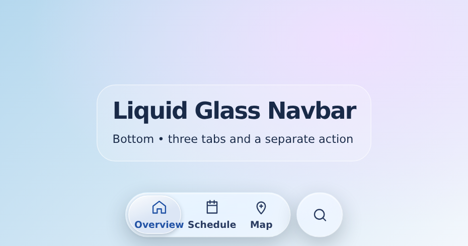

# Liquid Glass Navbar

**[Try it in the builder](https://soheab.com/navbar-builder/)**: set every option, preview it on a phone, tablet or desktop, and copy the code.

A framework-free TypeScript component for a glass tab bar. The lens follows a drag and settles on release. The host app supplies the buttons and handles navigation; the navbar marks the tab you pick as current.



## Options in pictures

| Option | Rendered examples |
| --- | --- |
| Placement | [Top](docs/mockups/position-top.png), [bottom](docs/mockups/position-bottom.png), [left](docs/mockups/position-left.png), [right](docs/mockups/position-right.png) |
| Groups | [One bar](docs/mockups/position-top.png) or [separate sections](docs/mockups/position-bottom.png) |
| Items | [Mixed icons and labels](docs/mockups/item-visibility.png), [icon-only item](docs/mockups/item-icon-only.png), [icons only across the bar](docs/mockups/position-left.png), [item with both parts hidden](docs/mockups/item-hidden.png) |
| Tint | [Opaque solid](docs/mockups/background-opaque.png), [partly transparent gradient](docs/mockups/background-gradient.png), [clear glass](docs/mockups/background-clear.png) |
| Interaction | [Selection lens under drag](docs/mockups/navbar-drag.png), [reorder mode](docs/mockups/reorder.png) |
| Palettes | [Light](docs/mockups/navbar-light.png) and [dark](docs/mockups/navbar-dark.png) |

See the [mockups gallery](docs/mockups/README.md) for larger previews and the [example source](examples/demo.ts) for the live controls.

## Install

Install it straight from GitHub. The package exports TypeScript and CSS for use with a bundler.

```sh
npm install 'git+https://github.com/soheab-com/liquid-glass-navbar.git#v0.1.1'
```

## Use

A navbar can contain direct buttons or groups marked with `data-navbar-section`. Groups can contain any combination of tabs and actions. This example uses Search as the separate action.

```html
<nav id="example-navbar" aria-label="Navigation">
  <div data-navbar-section>
    <button type="button" aria-current="page"><span data-navbar-label>Overview</span></button>
    <button type="button"><span data-navbar-label>Schedule</span></button>
    <button type="button"><span data-navbar-label>Map</span></button>
  </div>
  <div data-navbar-section>
    <button type="button" data-navbar-action aria-label="Search">
      <svg data-navbar-icon viewBox="0 0 24 24" aria-hidden="true" fill="none" stroke="currentColor">
        <circle cx="10" cy="10" r="6" /><path d="m15 15 5 5" />
      </svg>
    </button>
  </div>
</nav>
```

```ts
import { mountLiquidGlassNavbar } from '@soheab-com/liquid-glass-navbar';
import '@soheab-com/liquid-glass-navbar/navbar.css';

const nav = document.querySelector<HTMLElement>('#example-navbar')!;
const navbar = mountLiquidGlassNavbar(nav, {
  position: 'bottom',
  labels: true,
  background: 'linear-gradient(135deg, #d8eaff, #eee0f5)',
  transparency: 40,
  reorderable: true,
  onSelect(button) {
    // Show the page for this tab.
  },
  onAction(button) {
    button.dispatchEvent(new CustomEvent('open-search', { bubbles: true }));
  },
});
```

| Feature | API or markup |
| --- | --- |
| Position | Pass `position: 'top' \| 'bottom' \| 'left' \| 'right'` or call `setPosition(edge)`. Omit it to use your own layout. |
| Selection | Mark the starting tab with `aria-current="page"`. Tapping or swiping to a tab moves `aria-current` to it, then calls `onSelect` so you can show the page. Pass `autoSelect: false` to manage `aria-current` yourself, for example with a router, and call `sync()` after changing it. Also call `sync()` after changing availability or theme. Actions use `data-navbar-action` and do not change the current tab. A swipe can end on an action: releasing there calls `onAction` and the lens returns to the current tab. |
| Labels and icons | Use `data-navbar-label` and `data-navbar-icon` on their elements. Either element can be omitted. Supply `aria-label` for icon-only buttons. |
| Visibility | Use `labels: false` or `setLabels(false)` for the whole bar. For one item, use `setItemVisibility(button, { icon: false, label: false })` or the `data-navbar-hide-icon` and `data-navbar-hide-label` attributes. Hiding both parts removes the item from the layout and drag targets. |
| Background | Pass `background` or call `setBackground(value)` with a CSS background value, such as a color or gradient. Call with no argument to use the theme's surface again. |
| Transparency | Pass `transparency` or call `setTransparency(percent)`. The tint ranges from 0% transparent to 100% clear. Omit the value to use the theme default. |
| Reordering | With `reorderable: true`, use Alt+Arrow on a focused button or turn on `setReorderMode(true)` for pointer and touch dragging. Call `reorder(buttons)` for programmatic ordering. Pass every button in one section exactly once. Use `onReorder` to persist the new order. |
| Cleanup | Call `destroy()` before unmounting the nav. |

Customize the palette with `--lg-nav-surface`, `--lg-nav-opaque`, `--lg-nav-rim`, `--lg-nav-highlight`, `--lg-nav-shadow`, `--lg-nav-accent`, and `--lg-nav-muted`. The component respects reduced-motion and reduced-transparency preferences.

## Run the examples

```sh
npm ci
npm run check
npm run demo
```

Open `http://127.0.0.1:4173/examples/`. The controls let you change options without editing code.

## Disclaimer

Not affiliated with or endorsed by Apple Inc. Apple and iOS are trademarks of Apple Inc. Liquid Glass is the name Apple uses for its design style. This is an independent take on the look.
