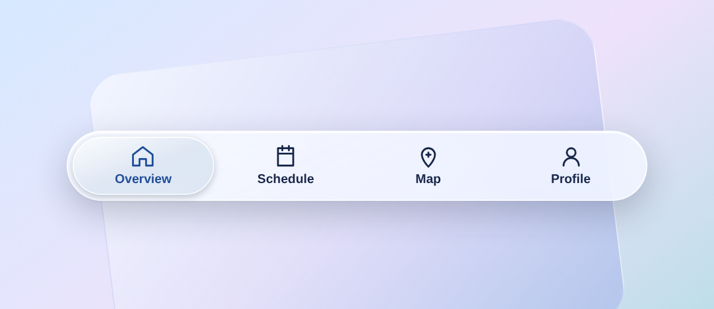
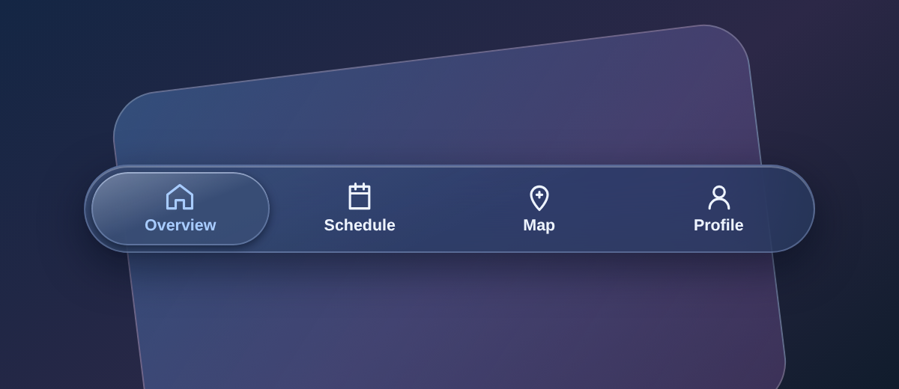
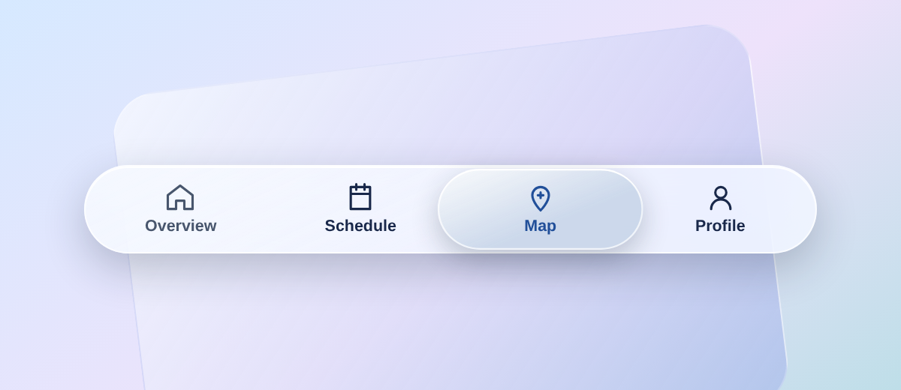

# Liquid Glass Navbar

A browser component for a floating glass tab bar. It covers the selection lens, drag and release, spring motion, native tap and keyboard selection, and reduced-motion support. The host supplies the tabs, placement, and navigation.

## Preview

| Light | Dark |
| --- | --- |
|  |  |



## Installation

Install from the private GitHub repo at a pinned revision.

```sh
npm install 'git+https://github.com/soheab-com/liquid-glass-navbar.git#v0.1.1'
```

The package exports TypeScript source and CSS for use in a bundler. The build machine needs GitHub access to the private repository.

```ts
import { mountLiquidGlassNavbar } from '@soheab-com/liquid-glass-navbar';
import '@soheab-com/liquid-glass-navbar/navbar.css';

const nav = document.querySelector<HTMLElement>('nav')!;
const navbar = mountLiquidGlassNavbar(nav, {
  enabled: () => document.documentElement.classList.contains('glass-theme'),
  onSelect(button) {
    nav.querySelector('[aria-current="page"]')?.removeAttribute('aria-current');
    button.setAttribute('aria-current', 'page');
    navbar.sync();
  },
});
```

Use direct `<button type="button">` children, mark the current one with `aria-current="page"`, and give the nav a positioned flex or grid layout. Call `sync()` after a theme change or app-driven selection, and `destroy()` before removing a mounted nav. Omitting `enabled` keeps the glass effect on.

Set `--lg-nav-surface`, `--lg-nav-opaque`, `--lg-nav-rim`, `--lg-nav-highlight`, `--lg-nav-shadow`, `--lg-nav-accent`, and `--lg-nav-muted` to match your palette. The app controls positioning, tab width, and labels.
