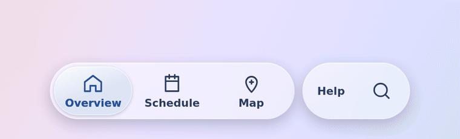

# Liquid Glass Navbar

A glass tab bar for the web, in the style of iOS. You write the buttons, it adds the glass, the sliding highlight and the swipe gesture. It's plain TypeScript and CSS, so it works with any framework or none.

[Try it in the builder](https://soheab.com/navbar-builder/). You can change every option there, see it on a phone, tablet or desktop, and copy the code.

<picture>
  <source media="(prefers-color-scheme: dark)" srcset="docs/mockups/showcase-dark.gif">
  
</picture>

## Install

It isn't on npm. Install it from GitHub:

```sh
npm install 'git+https://github.com/soheab-com/liquid-glass-navbar.git#v0.6.0'
```

You need a bundler (Vite, esbuild, webpack and so on), because the package ships TypeScript and CSS.

## Quick start

Write a normal `<nav>` with buttons. Mark the label and icon in each button, and mark the tab you start on with `aria-current="page"`.

```html
<nav id="tabs" aria-label="Main">
  <button type="button" aria-current="page">
    <svg data-navbar-icon viewBox="0 0 24 24" aria-hidden="true">...</svg>
    <span data-navbar-label>Home</span>
  </button>
  <button type="button">
    <svg data-navbar-icon viewBox="0 0 24 24" aria-hidden="true">...</svg>
    <span data-navbar-label>Schedule</span>
  </button>
  <button type="button">
    <svg data-navbar-icon viewBox="0 0 24 24" aria-hidden="true">...</svg>
    <span data-navbar-label>Map</span>
  </button>
</nav>
```

Then turn it into a navbar:

```ts
import { mountLiquidGlassNavbar } from '@soheab-com/liquid-glass-navbar';
import '@soheab-com/liquid-glass-navbar/navbar.css';

const navbar = mountLiquidGlassNavbar(document.querySelector('#tabs')!, {
  position: 'bottom',
  onSelect(button) {
    // Show the page that belongs to this tab.
  },
});
```

The navbar uses the platform UI font by default. Set `--lg-nav-font` on the navbar to use a different font stack.

Tapping or swiping to a tab moves `aria-current` to it and calls `onSelect`. Showing the right page is up to you.

If every tab is its own page, use links instead of buttons: `<a href="/schedule">`. Tapping a link, or ending a swipe on it, follows it like any other link.

## Sections and actions

To split the bar into separate pills, wrap groups of buttons in `data-navbar-section`. A button with `data-navbar-action` is something you do, like Search or opening a menu, so it never becomes the current tab. Tapping it, or ending a swipe on it, calls `onAction`.

```html
<nav id="tabs" aria-label="Main">
  <div data-navbar-section>
    <button type="button" aria-current="page"><span data-navbar-label>Home</span></button>
    <button type="button"><span data-navbar-label>Schedule</span></button>
  </div>
  <div data-navbar-section>
    <button type="button" data-navbar-action aria-label="Search">
      <svg data-navbar-icon viewBox="0 0 24 24" aria-hidden="true">...</svg>
    </button>
  </div>
</nav>
```

Give icon-only buttons an `aria-label`, so screen readers have something to read.

## Refraction

On browsers that support SVG backdrop filters, the glass bends the actual text, images, and colors behind it. No extra markup is needed.

Safari uses its live blur and tint. SVG backdrop displacement is currently available in Chromium.

Icons and labels keep their configured colors and use a contrasting edge to stay legible over changing content.

The displacement map is generated in the browser. Sites with a Content Security Policy need `data:` in `img-src` for this effect.

## Options

Pass these to `mountLiquidGlassNavbar`. All of them are optional.

| Option | What it does |
| --- | --- |
| `position` | `'top'`, `'bottom'`, `'left'` or `'right'` pins the bar to that edge of the screen. Leave it out to place the bar yourself. |
| `labels` | `false` hides every label and shows icons only. |
| `equalWidth` | `true` makes every tab as wide as the longest one, so the highlight is the same size on every tab. |
| `equalWidthOverflow` | What equal widths do when the bar is too narrow. `'natural'` (the default) goes back to normal widths until there's room. `'truncate'` keeps them equal and cuts long labels off with "…". `'grow'` keeps them equal and lets the bar get wider, so your layout has to make room. |
| `colors` | Tab colours, see [Colours](#colours). |
| `background` | Any CSS background, like `'#adc9ef'` or a gradient, to tint the glass. |
| `transparency` | Adjusts glass tint, blur, and refraction from `0` (solid) to `100` (clear, with native rim refraction where supported). |
| `reorderable` | `true` lets people reorder tabs, see [Reordering](#reordering). |
| `autoSelect` | `false` stops the navbar from moving `aria-current` itself. Use this with a router: change `aria-current` yourself, then call `sync()`. |
| `enabled` | A function that returns `false` to switch the glass off, for example in a theme that shouldn't have it. |
| `onSelect(item)` | Called when someone picks a tab. `item` is the button or link. |
| `onAction(item)` | Called when someone picks an action. |
| `onReorder(order, section)` | Called after tabs are reordered, so you can save the order. |
| `layout` | `'row'` (the default), `'wrap'` or `'rows'`. See [Rows and More](#rows-and-more). |
| `maxRows` | With `overflow`, how many rows to use before items move into More. |
| `overflow` | `true`, `'menu'`, `'expand'` or an options object. Items that don't fit move into a More button. |
| `onOverflowChange(items)` | Called when items move between the bar and More. |
| `compact` | `true` starts with icons only. |
| `scrollCompact` | `true` or `{ source, threshold }`. Scrolling down compacts the bar and scrolling up restores the labels. |
| `onCompactChange(compact)` | Called when the bar compacts or expands. |
| `contrast` | `true` or `{ regions, adaptiveTint }`. See [Adaptive contrast](#adaptive-contrast). |

## Changing things later

`mountLiquidGlassNavbar` returns an object you can use to change the bar after it's on the page.

| Method | What it does |
| --- | --- |
| `setPosition(edge)` | Moves the bar to another edge. Call it with nothing to let your own layout place it again. |
| `setLabels(visible)` | Shows or hides all labels. |
| `setEqualWidth(equal, overflow?)` | Turns equal widths on or off, and optionally changes what happens when they don't fit. |
| `setColors(colors?)` | Changes the tab colours. Call it with nothing to go back to the theme's colours. |
| `setBackground(value?)` | Changes the tint. Call it with nothing to go back to the theme's glass. |
| `setTransparency(percent?)` | Changes how see-through the tint is. |
| `setItemVisibility(button, { icon, label })` | Hides the icon or label of one tab. Hiding both hides the whole tab. You can also use the `data-navbar-hide-icon` and `data-navbar-hide-label` attributes. |
| `setReorderMode(on)` | Turns drag-to-reorder on or off. |
| `reorder(buttons)` | Puts the tabs of one section in a new order. Pass every button of that section once. |
| `select(item)` | Marks a tab as current without calling `onSelect`, for example to restore a saved tab. Works for tabs behind More. |
| `setLayout(layout, maxRows?)` | Changes the layout and row limit. |
| `setOverflow(overflow?)` | Turns More on, changes its style, or turns it off. |
| `overflowItems` | The items behind More right now. |
| `openOverflow({ focus })`, `closeOverflow()` | Opens or closes More from your own code. |
| `setBadge(item, badge)` | Shows `{ count }`, `{ dot: true }` or `{ status, label }` on an item. Pass `null` to remove it. |
| `setCompact(on)`, `setScrollCompact(options?)` | Compacts the bar yourself, or changes the scroll watcher. |
| `setContrast(options?)`, `setBackdrop(signal?)` | Changes contrast settings, or tells the bar what's behind it: `{ tone: 'dark', busy: true }`. |
| `showContextActions(nodes, { label })`, `hideContextActions()` | Swaps the navigation for your own actions, then brings it back with the same tab selected. |
| `createPopover(item, content, options)` | Anchors a popover to one of the bar's items. See [Popovers](#popovers). |
| `sync()` | Tells the navbar something changed: the current tab, a hidden tab, or the theme. |
| `destroy()` | Removes everything the navbar added. Call it before you remove the `<nav>`. |

## Colours

Tabs have two states. Selected is whatever the highlight is over: the current tab, or the nearest tab while you drag. Unselected is everything else.

```ts
navbar.setColors({
  selected: '#e8590c',
  unselected: '#495057',
});
```

You can also colour icons and labels differently. These override `selected` and `unselected` for just that part:

```ts
navbar.setColors({
  selected: '#7048e8',
  selectedLabel: '#1c7ed6',
  unselectedIcon: '#868e96',
});
```

If you prefer CSS, set the same colours as variables on the nav. `--lg-nav-accent` is selected and `--lg-nav-muted` is unselected. The icon and label versions are `--lg-nav-icon-accent`, `--lg-nav-label-accent`, `--lg-nav-icon-color` and `--lg-nav-label-color`. The glass itself uses `--lg-nav-surface`, `--lg-nav-opaque`, `--lg-nav-rim`, `--lg-nav-highlight` and `--lg-nav-shadow`.

## Dragging

Press a tab and slide along the bar. The highlight follows your finger and swells into a clear bubble. The tab closest to the bubble takes the selected color. Let go and it settles on the nearest tab, keeping the speed you let go at. Pull past the first or last tab and it stretches like a rubber band instead of stopping dead.

People who turn on Reduce Motion get the same result without the animation, and Reduce Transparency swaps the default glass for a solid colour. An explicit transparency setting takes precedence.

Swipes can start or land on tabs and actions, including across sections. Add `data-navbar-no-swipe` to an item or section to exclude it from the swipe gesture. Tapping and keyboard activation still work.

## Reordering

With `reorderable: true`, people can move a focused tab with Alt and the arrow keys. To let them drag tabs around with a mouse or finger too, call `setReorderMode(true)`, for example from an "Edit" button. Tabs only move within their own section. Use `onReorder` to save the new order.

## Rows and More

Everything here is optional; a bar without these options behaves as before. Multi-row layouts and More apply to bars along the top or bottom, or bars you place yourself.

```ts
mountLiquidGlassNavbar(nav, { layout: 'wrap' });             // rows inside one glass surface
mountLiquidGlassNavbar(nav, { layout: 'rows' });             // one centered pill per row
mountLiquidGlassNavbar(nav, { overflow: true });             // one row; extra items go into a More menu
mountLiquidGlassNavbar(nav, { layout: 'wrap', maxRows: 2, overflow: 'menu' });
mountLiquidGlassNavbar(nav, { overflow: { style: 'expand', surface: 'individual', maxVisible: 4 } });
```

The bar measures the real icons, full labels, padding and gaps, including More itself, and reflows when the space changes. The current tab stays selected when it moves into More or back; More shows it as current while it's inside. Items keep their focus when they move.

- Put an item or a `[data-navbar-section]` on a row with `data-navbar-row="1"`, `"2"` and so on.
- Keep an item in the bar with `data-navbar-overflow="never"`.
- `overflow` options: `style` (`'menu'` or `'expand'`), `surface` (`'shared'` pill or `'individual'` glass icons, for `expand`), `label`, `icon`, `maxVisible` and `boundary`.

More closes when another tab is pressed, on an outside press, after a selection, and on Escape. Focus goes back to More when it was inside.

## Swiping across rows

When the bar has rows or a More button, the highlight follows your finger in both directions and lifting selects whatever is under it. Slide onto More and it opens without ending the gesture, so the same finger can carry on into the new row. Actions and other sections take part; `data-navbar-no-swipe` on an item or section still opts out.

## Popovers

`createPopover` anchors a popover to an item, for example a Create action. Tapping or swiping to the item toggles it, and a small pointer stays aligned with the item when the popover shifts away from an edge or flips below.

```ts
const create = nav.querySelector<HTMLButtonElement>('#create')!;
navbar.createPopover(create, [newNoteButton, newFolderButton], { label: 'Create' });
```

`createAnchoredPopover(trigger, content, options)` is exported for triggers outside the bar. Style it with `.lg-popover` and `--lg-popover-background`.

## Badges

```ts
navbar.setBadge(chats, { count: 3, label: '3 unread' });
navbar.setBadge(updates, { dot: true, label: 'New updates' });
navbar.setBadge(sync, { status: 'warning', label: 'Sync paused' });
navbar.setBadge(chats, null);
```

The label is announced with the item. When an item with a badge is behind More, More shows a dot. Colours: `--lg-nav-badge`, `--lg-nav-badge-color`.

## Scroll compact and context actions

```ts
mountLiquidGlassNavbar(nav, { scrollCompact: { source: document.querySelector('#feed')! } });

navbar.showContextActions([shareButton, moveButton, doneSection], { label: 'Actions for 2 files' });
navbar.hideContextActions(); // restores the navigation and the tab that was selected
```

Small reversals and rubber-band overscroll don't change the bar. The nodes you pass to `showContextActions` are your own items (mark actions with `data-navbar-action`) or `[data-navbar-section]` groups; they are removed again when you leave.

## Adaptive contrast

Mark content with `data-navbar-backdrop`, listing `dark`, `light` and/or `busy`:

```html
<section data-navbar-backdrop="dark busy">...</section>
```

```ts
mountLiquidGlassNavbar(nav, { transparency: 100, contrast: { adaptiveTint: true } });
navbar.setBackdrop({ tone: 'dark' }); // or tell it yourself
```

Over dark content the icons and labels switch to `--lg-nav-on-dark-color` and `--lg-nav-on-dark-accent`, also with clear glass. With `adaptiveTint`, busy content adds tint (`{ busy: 34 }` by default) and quiet content clears it again; without it, clear glass keeps zero tint. The bar still uses the live backdrop.

## Persistence

The navbar doesn't store anything. Save the tab in `onSelect` and restore it with `select(item)`, even when the item is behind More.

## Pictures

The [mockups](docs/mockups/README.md) show every option: the four [positions](docs/mockups/position-top.png), [icons and labels](docs/mockups/item-visibility.png), [tints](docs/mockups/background-gradient.png), [dragging](docs/mockups/navbar-drag.png), [reordering](docs/mockups/reorder.png), and the [light](docs/mockups/navbar-light.png) and [dark](docs/mockups/navbar-dark.png) looks.

## Run the demo

```sh
npm ci
npm run check
npm run demo
```

Open `http://127.0.0.1:4173/examples/` and play with the controls. The code is in [examples/demo.ts](examples/demo.ts).

## Changelog

See [CHANGELOG.md](CHANGELOG.md) for what changed in each version.

## Disclaimer

This project isn't made by, affiliated with or endorsed by Apple. Apple and iOS are trademarks of Apple Inc. Liquid Glass is Apple's name for its design style; this is an independent take on the look.
