# Mockups

Rendered from the navbar and the [runnable example](../../examples/index.html).

## Placement and sections

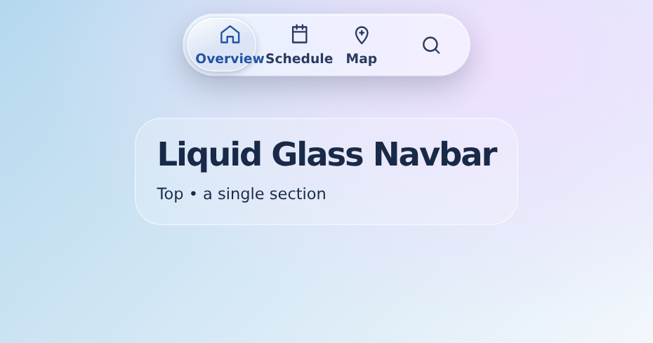
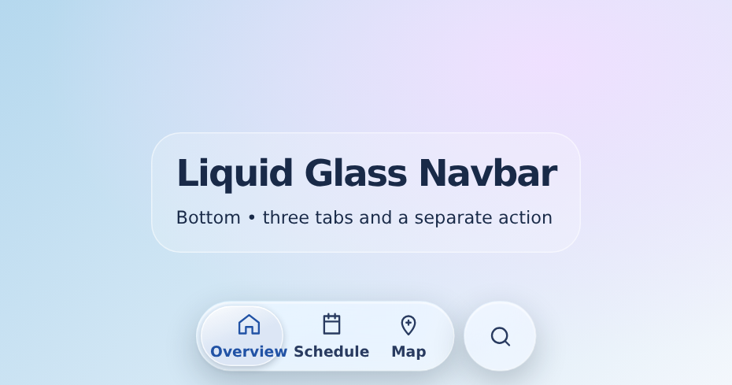

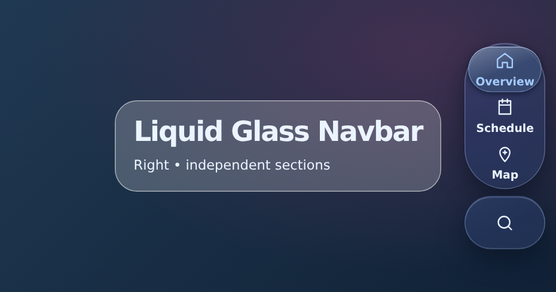

## Item visibility

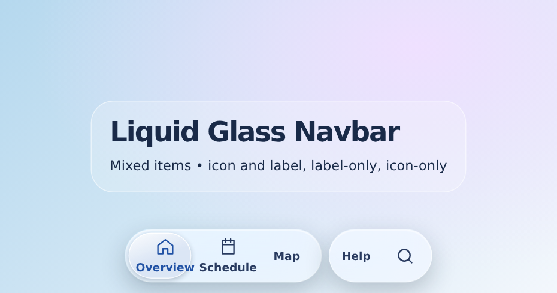
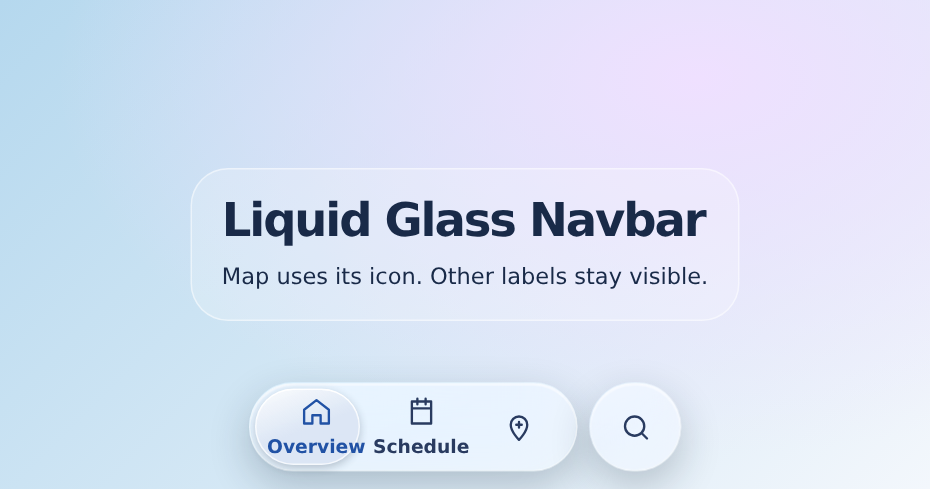
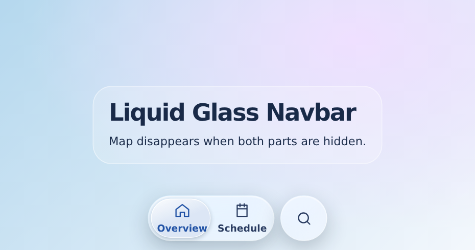

## Background and transparency

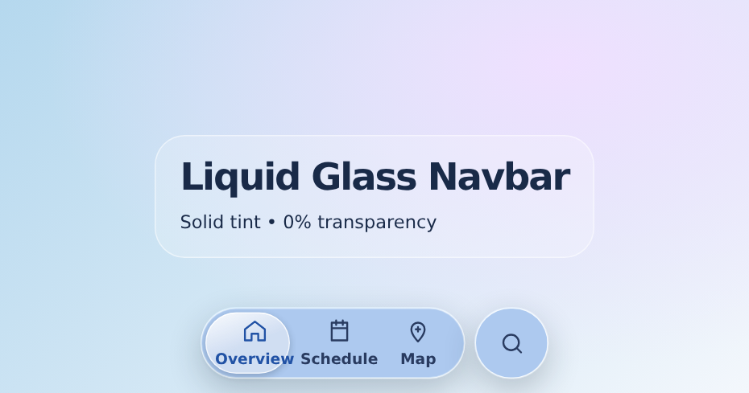
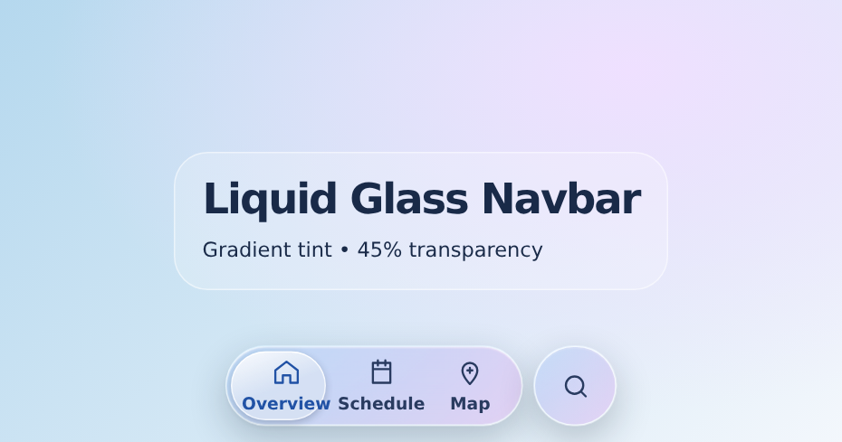
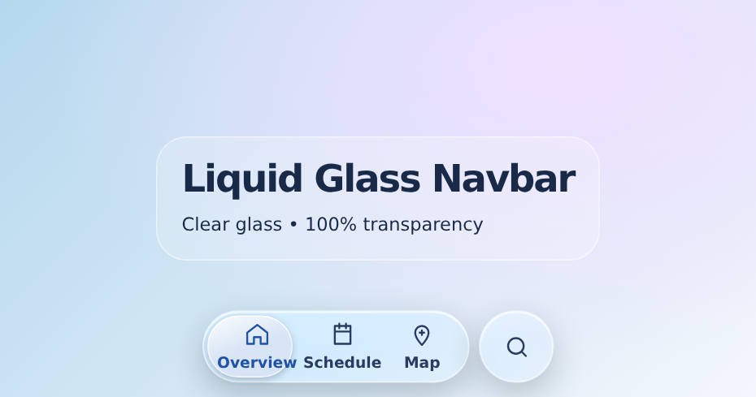

## Selection and reorder

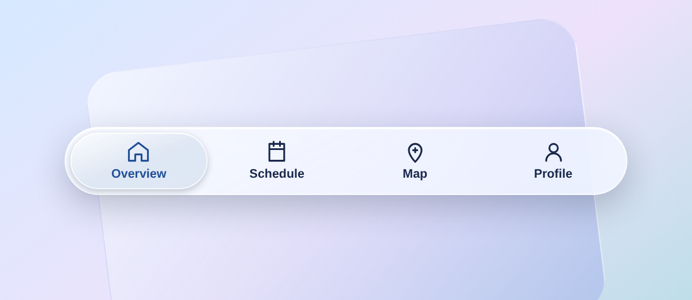
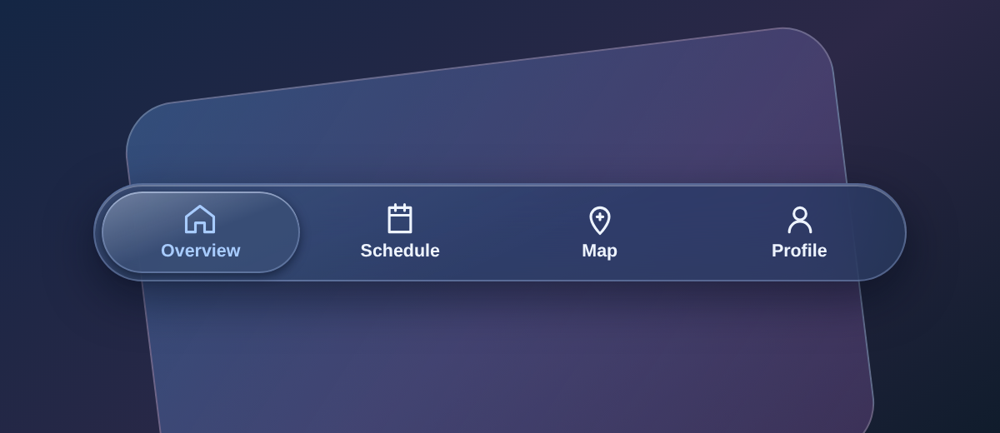
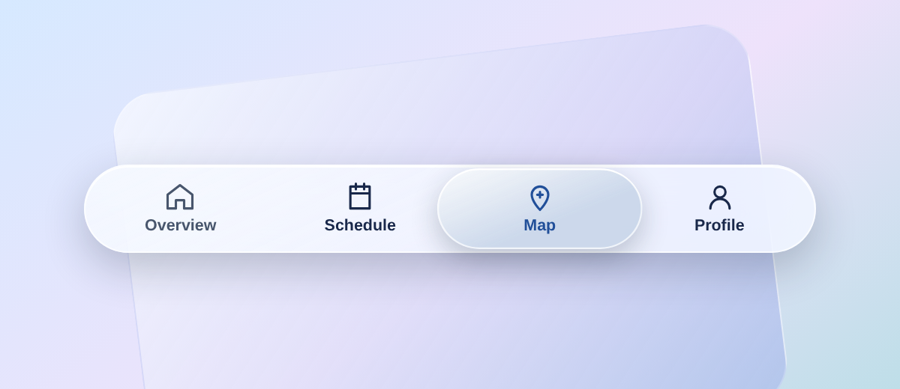
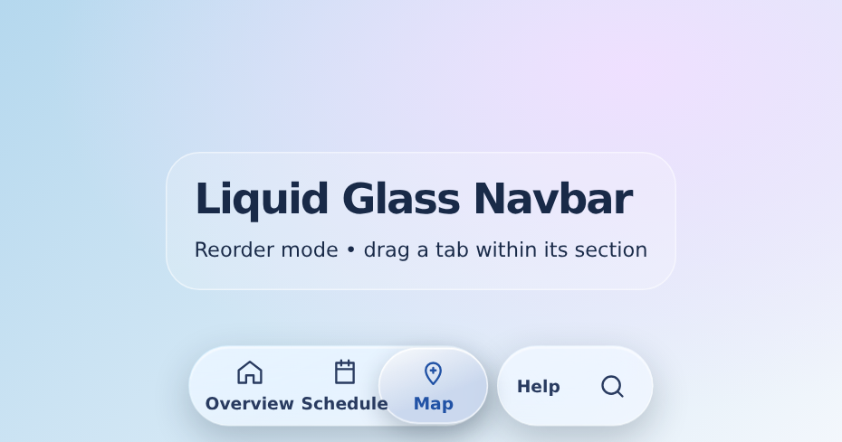
